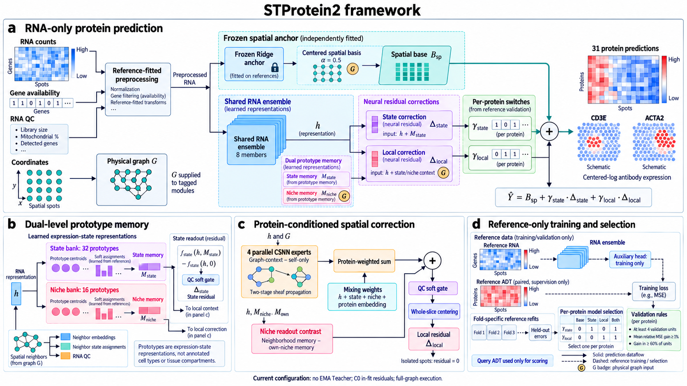

# STProtein2

**Spatial RNA-to-protein prediction with a frozen spatial anchor and prototype-guided residual corrections.** STProtein2 takes RNA counts and spatial coordinates and predicts a fixed panel of 31 centered-log protein targets.



The installable **`stprotein2`** package contains the core software. Evaluation tools and research experiments live in separate repository directories. The current algorithm configuration is v2.1; the source-layout version is `0.3.0.dev1`.

## Code structure

```text
STProtein2/
├── stprotein2/                 # The single installable source package
│   ├── models/                # Frozen anchor, RNA encoder, prototypes and sheaf experts
│   ├── training/              # Initialization, residual training and nested selection
│   ├── inference/             # Bundle export, loading and RNA-only prediction
│   ├── execution/             # Memory policies and graph partitioning
│   ├── data.py                # RNA/ADT data contracts and reference-fitted preprocessing
│   ├── graph.py               # Spatial graphs and frozen routing
│   ├── gates.py               # Per-protein validation switches
│   ├── config.py              # Shared model configuration
│   ├── provenance.py          # Shared source hashes and immutable snapshots
│   └── cli.py                 # Public command dispatcher
├── evaluation/                # Offline ADT scoring, spatial and domain metrics
├── research/                  # Ablations, baselines and historical training controls
├── configs/                   # Current full-size and small demo configurations
├── examples/                  # Synthetic input generator
├── tests/                     # Unit, training and deployment regression tests
├── docs/                      # Architecture, API and validation notes
└── fig/                       # Framework figure and legend
```

Start with [`models/spatial.py`](stprotein2/models/spatial.py) for the complete model, [`training/nested.py`](stprotein2/training/nested.py) for the supported training pipeline, and [`inference/bundle.py`](stprotein2/inference/bundle.py) for deployment. [The code map](docs/CODE_LAYOUT.md) explains each component and the migration from the first upload.

## Method

The current configuration uses an eight-member RNA ensemble, 32 state prototypes, 16 niche prototypes and four cooperative sheaf experts. A separately fitted, frozen Ridge anchor plus a fixed centered spatial basis provides the base prediction. State and local residuals are added through reference-selected binary switches for each protein:

$$\widehat{Y}=B_{\mathrm{sp}}+\gamma_{\mathrm{state}}\Delta_{\mathrm{state}}+\gamma_{\mathrm{local}}\Delta_{\mathrm{local}}.$$

`configs/latest.json` specifies hierarchical reference-only initialization, C0 in-fit residual targets, no EMA teacher, full-graph execution and spatial coefficient 0.5. Query ADT is used only by the separate scoring command. [Architecture details](docs/ARCHITECTURE.md) describe the target panel and validation rules.

This remains a research implementation. Independent confirmation of residual gains and superiority over competitors is ongoing; the framework image is schematic.

## Install

Python 3.10 or newer is required.

```bash
git clone https://github.com/zhaorui-bi/STProtein2.git
cd STProtein2
python -m venv .venv
source .venv/bin/activate
python -m pip install --upgrade pip
python -m pip install -e .
```

Full-graph execution needs no PyTorch Geometric, METIS or Leiden. Optional partition controls use `python -m pip install -e '.[test,partition]'`.

## Quick start

The small synthetic example exercises training, export and inference. It creates paired reference files and RNA-only query input. Its reduced model and three-epoch budget are for installation checks. Three reference groups cannot open the validation switches, so the demo's selected prediction uses the spatial base.

```bash
python examples/make_demo.py --output demo/data

stprotein2 train \
  --registry demo/data/registry.json --groups demo/data/groups.json \
  --config configs/demo.json --query query \
  --output demo/run --anchor-cache demo/anchors --device cpu

stprotein2 export --run demo/run --output demo/bundle

stprotein2 predict \
  --bundle demo/bundle --rna demo/data/query_rna.h5ad \
  --sample query --output demo/prediction --device cpu
```

Use `stprotein2 --version` to identify the installation, and `stprotein2 --help` or `stprotein2 train --help` for available commands and options. `python -m stprotein2` provides the same interface. The older `stprotein2-train` and `stprotein2-predict` console aliases remain available.

## Real-data training and prediction

RNA files are AnnData `.h5ad` objects with raw nonnegative integer counts in `.X`, unique gene IDs and spot barcodes, and two-dimensional coordinates in `.obsm['spatial']`. Reference ADT files contain raw counts for the 31 named targets, aligned by spot barcode. Inputs and grouping examples are documented in [the API guide](docs/API.md).

```bash
stprotein2 train \
  --registry /path/registry.json --groups /path/groups.json \
  --config configs/latest.json --query query \
  --output runs/query --anchor-cache cache/anchors --device cuda \
  --cuda-allocator-gib 8

stprotein2 export --run runs/query --output exports/query_model

stprotein2 predict \
  --bundle exports/query_model --rna /path/new_slice_rna.h5ad \
  --sample new_slice --output predictions/new_slice --device cpu
```

`stprotein2 prepare` accepts the training arguments and builds reference-only anchors before training. `train` also prepares them when needed. The CUDA allocator setting is a process allocator cap, not a guarantee that a dataset fits.

Prediction needs the bundle and one complete RNA slice. Outputs include named `prediction.h5ad`, numerical prediction components, gene-coverage diagnostics and integrity manifests. If query ADT is available, score completed predictions separately:

```bash
python -m evaluation run \
  --registry /path/registry.json --output runs/query \
  --report-dir reports/query --extended --cluster-counts 4 6 8

python -m evaluation prediction \
  --registry /path/application_registry.json --prediction predictions/new_slice \
  --output reports/new_slice --extended --cluster-counts 4 6 8
```

Evaluation commands run from the repository root after installing the core package. See the [evaluation guide](evaluation/README.md) for metrics and inputs, and the [research guide](research/README.md) for experimental controls. The application registry must name the sample passed to `predict --sample` and supply its original RNA file and measured ADT. Neither evaluation nor research is included in the core wheel.

## Validation and provenance

```bash
python -m pip install -e '.[test]'
python -m pytest -q
```

The [layout validation record](docs/LAYOUT_VALIDATION.md) reports the checks for this reorganization. Source-integrity checks use the same unified package paths in editable and wheel installations. Historical development protocols and earlier validation evidence are retained in [`docs/history/`](docs/history/). See [the documentation index](docs/README.md), [troubleshooting](docs/TROUBLESHOOTING.md) and [CONTRIBUTING.md](CONTRIBUTING.md) for use and development.

Layout changes alter source identities. Use fresh cache and output directories with the current version; retain the matching environment for older runs and bundles. See [the change log](CHANGELOG.md) for migration details.

## References and license

- [STProtein: predicting spatial protein expression from multi-omics data](https://arxiv.org/abs/2602.05811), Jiang et al., 2026.
- [Cooperative Sheaf Neural Networks](https://proceedings.iclr.cc/paper_files/paper/2026/hash/ea1a7f7bc0fc14142106a84c94c826d0-Abstract-Conference.html), Ribeiro et al., ICLR 2026. CSNN is prior work; this repository independently adapts its operator.
- [Upstream notes](docs/UPSTREAM.json) describe implementation and preprocessing lineage.

Source code retains the [GPL v3 license](LICENSE) of [STProtein](https://github.com/zhaorui-bi/STProtein).
